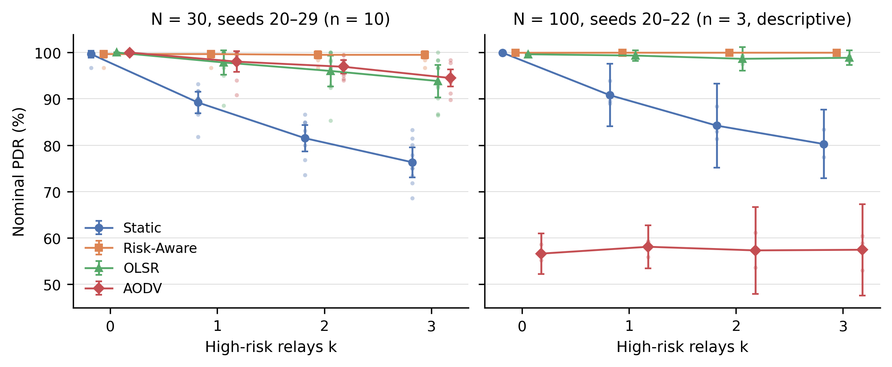
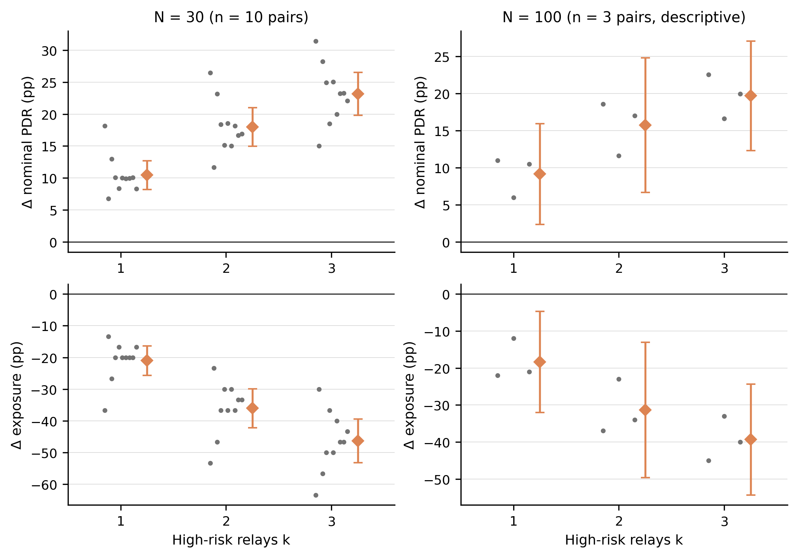
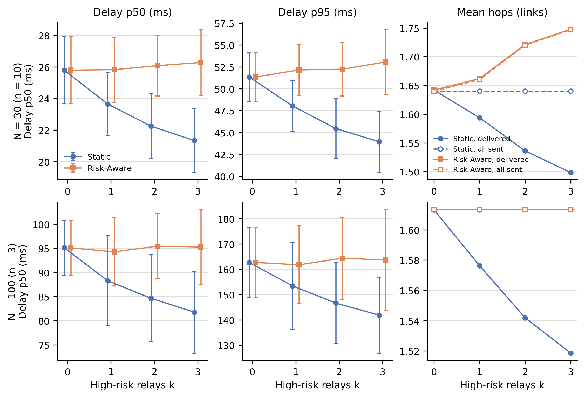
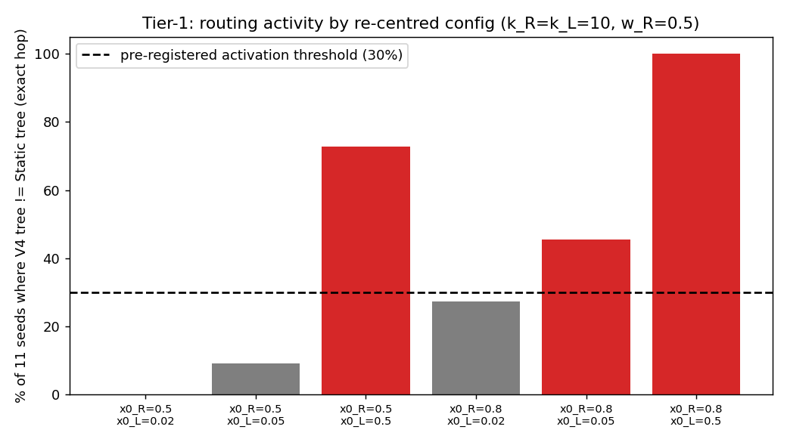
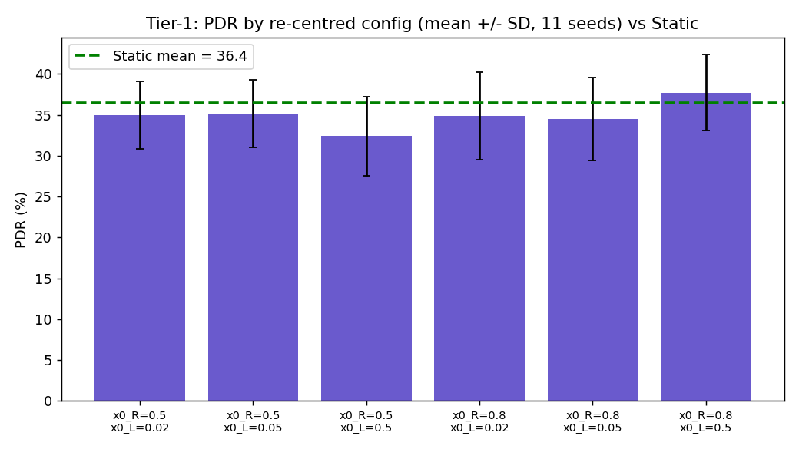

<div align="center">

# Analysis of Gateway-Centric IoT Wireless Mesh Networks Using NS-3

**Where multi-hop IoT networks lose packets, and how routing can avoid unreliable relays:<br>
an IEEE 802.11b bottleneck study and a Wi-Fi 6 risk-aware routing study, both simulated in ns-3.**

[](https://www.nsnam.org/)
[](#methodology)
[](#wi-fi-6-risk-aware-routing-2026-10)
[](#research-highlights-wi-fi-6-risk-aware-routing)

**Salinthip Keereerat** · College of Computing, Prince of Songkla University, Phuket Campus<br>
Advisor: Komsan Kanjanasit · Co-Advisors: Wisarut Chantara, Kullawat Chaowanawatee

**[Live dashboard](https://salincalyna.github.io/-iot-network-performance-ns3/site/index.html)** ·
[Methodology](#methodology) · [Results](#results--figures) · [Reproducibility](#reproducibility)

</div>

---

**Contents:** [Summary](#executive-summary) · [At a glance](#research-at-a-glance) ·
[Key findings](#key-findings) · [Status](#research-status) · [Questions](#research-questions--objectives) ·
[Methodology](#methodology) · [Results](#results--figures) · [Limitations](#limitations) ·
[Reproducibility](#reproducibility) · [History](#research-history) · [Team](#research-team) ·
[Documentation](#references--documentation)

## Executive summary

IoT deployments often funnel every sensor's traffic to one gateway over multi-hop wireless
links, so a few congested or unreliable relays can decide the network's reliability. This project
uses the ns-3 simulator to locate those weak points and to test whether routing can avoid them.
The frozen IEEE 802.11b study (Phases 1–7, 1,782 baseline runs) identifies gateway and first-hop
congestion as the dominant measurable bottleneck and shows that reducing offered traffic improves
OLSR delivery at high node counts. An independent 51-run validation reproduced these results.
The Wi-Fi 6 study adds explicit low-risk and high-risk relay states to an 802.11ax mesh. It
compares Static, Risk-Aware, OLSR and AODV routing in matched experiments. With three high-risk
relays at N = 30, Risk-Aware routing raised delivery by 23.18 percentage points and cut risk
exposure by 46.33 points.

## Research at a glance

| Count | What it measures |
|---:|---|
| **1,782** | V3 baseline runs, IEEE 802.11b (seeds 20–30) |
| **208** | Wi-Fi 6 main-study runs: N = 30 (160) and N = 100 (48) |
| **4** | Wi-Fi 6 routing protocols: Static, Risk-Aware, OLSR, AODV |
| **10** | seeds at N = 30 — inferential statistics |
| **3** | seeds at N = 100 — descriptive only |

## Key findings

### Research highlights: Wi-Fi 6 Risk-Aware Routing

Risk-Aware − Static on the same seed, with k = 3 high-risk relays, 8 kbps per sensor:

| Measure | N = 30 · 10 seeds · inferential | N = 100 · 3 seeds · descriptive only |
|---|---|---|
| Nominal PDR | **+23.18 pp**<br>95 % CI [+19.81, +26.54] · 10/10 pairs | **+19.70 pp**<br>descriptive t interval [+12.32, +27.09] · 3/3 seeds |
| Risk exposure | **−46.33 pp**<br>95 % CI [−53.21, −39.46] · 10/10 pairs | **−39.33 pp**<br>descriptive t interval [−54.31, −24.35] · 3/3 seeds |
| Test | exact Wilcoxon p = 0.00195; Holm-adjusted p = 0.0117 | none — no significance claimed |

- **Cost of risk avoidance:**
  - At N = 30, p95 delay is +4.1 to +9.1 ms higher and gateway airtime +0.005 to +0.013, at
    k = 1–3. Risk-Aware paths really do lengthen, from 1.64 to 1.75 links over all sent packets at
    k = 3.
  - At N = 100, path length is unchanged (1.613 links at every k). Risk-Aware's delay stays within
    −1.1 to +2.5 ms of its own k = 0 run.
- **AODV at N = 100 (secondary finding):**
  - AODV delivered 56.60 ± 1.76 % against OLSR's 99.62 ± 0.04 % (k = 0, 3 seeds). The level is
    nearly the same at every k, so the risk model is not the cause. At N = 30 (k = 0, 10 seeds),
    AODV delivers 99.99 %.
  - The Block Ack fix was excluded as the cause: switching it off gave 53.21 % against 55.13 %
    with it on (seed 20).
  - A route-maintenance feedback loop is suspected. This is a **hypothesis** and was not isolated
    experimentally.

### IEEE 802.11b study (frozen, Phases 1–7)

> Gateway and first-hop congestion is the dominant measurable bottleneck under near-saturated
> conditions, and reducing offered traffic rate can effectively mitigate this bottleneck and
> improve PDR in OLSR networks at high node densities. However, the effectiveness of the
> intervention is protocol- and load-dependent, and a portion of packet loss remains unattributed
> by the current instrumentation.

1. Performance degrades as node count and traffic load increase, consistently across AODV, OLSR and Static. *(V3 baseline, 1,782 runs)*
2. V4 sigmoid-based adaptive routing re-routed up to 100 % of seeds relative to Static's shortest-path tree, but produced no statistically credible improvement over Static. This is a valid negative result, not a failed implementation. *(V4 matched/sensitivity/Tier-1)*
3. Gateway and first-hop congestion is the dominant measurable bottleneck. Gateway airtime reaches about 0.86–0.89 at high node counts under high traffic, and MAC-queue drops are 1.2–2.4× over-represented in the first-hop neighbourhood. NO_ROUTE / ROUTE_ERROR drops are negligible in every tested condition. *(176-run bottleneck characterisation)*
4. MAC-layer retry exhaustion exists, but it is not the dominant mechanism: a mean of roughly 6 % of loss, concentrated farther from the gateway. *(36-run validation)*
5. Reducing the offered rate (16 → 12 → 8 → 4 kbps) improves OLSR PDR by about +14.7 pp at N = 75 and +25.2 pp at N = 100 at the deepest cut. At N = 100, delivered throughput rises, a sign of recovery from congestion collapse. *(72-run offered-rate sweep)*
6. Static routing at N = 50 shows no improvement from rate reduction: PDR is flat to negative across all rates and seeds. The mechanisms the intervention relieves (airtime, MAC-queue overflow) were never the dominant source of loss there. *(12-run diagnostic)*
7. Part of the loss remains unattributed by the instrumentation. At Static/N = 50, residual loss is 64.65 %–99.57 % (typically ≥ 92 %), while attributed mechanisms account for about 0.4–35.4 %. This is an instrumentation limitation, not a claim about an unmeasured cause. *(Static/N = 50 diagnostic)*

## Research status

| Track | Network | Status |
|---|---|---|
| Phases 1–7 (V3 baseline to reproducibility) | IEEE 802.11b mesh | **Frozen** — reproducible (51/51 validation runs) |
| Wi-Fi 6 Risk-Aware Routing (low/high-risk relays, k = 0–3) | IEEE 802.11ax mesh | **Completed and validated** (2026-10): N = 30 (10 seeds), N = 100 (3 seeds) |
| N = 100 saturated-load risk experiment | IEEE 802.11ax mesh | **Not run** — pending approval |
| Phase 8: BA topology / risky-node routing | Barabasi-Albert graph | **Proposed** — not yet executed ([details](#phase-8-ba-topology--risky-node-routing-proposed)) |

The Wi-Fi 6 study and the proposed Phase 8 BA study are separate investigations, on different
topologies, run with different simulators.

## Research questions & objectives

**IEEE 802.11b study.** *What is the main cause of packet loss in a multi-hop IoT network as
network size and traffic load increase, and can the identified bottleneck be mitigated by reducing
offered traffic rate?* The objective is to identify the factors affecting performance and packet
loss in a multi-hop IoT network using NS-3, and to evaluate whether appropriate traffic management
can mitigate congestion and improve network reliability.

**Wi-Fi 6 Risk-Aware Routing study.**
1. Measure how 0–3 high-risk relay nodes affect delivery and risk exposure under Static, OLSR and
   AODV routing.
2. Test whether risk-aware route selection reduces exposure and loss, and at what cost in delay,
   path length and airtime.
3. Check whether the result holds when the network grows from 30 to 100 sensors.

## Methodology

### IEEE 802.11b study (frozen)

- **Network:** a multi-hop IEEE 802.11b ad-hoc IoT mesh with one central gateway.
- **Protocols:** AODV, OLSR and Static routing, plus the V4 sigmoid-based adaptive routing
  investigation.
- **Baseline:** the official V3 baseline (`scratch/iot-network-v3-ext.cc`) covers the full
  node-count / traffic / mobility matrix in 1,782 runs (seeds 20–30).
- **Probe simulator:** `scratch/iot-network-bottleneck-probe.cc` was used for the bottleneck,
  retry, rate-intervention and Static/N = 50 phases. It replicates the V3 topology, PHY/MAC and
  traffic exactly, and adds per-node instrumentation: airtime, MAC-queue drops, PHY RX drops,
  retry-exhaustion drops and hop distance.
- **Exact parameters:**
  [`config_fingerprint.txt`](analysis/final-reproducibility-check/config_fingerprint.txt) and
  [`REPORT_DATA_DICTIONARY.md`](analysis/final-report-data/REPORT_DATA_DICTIONARY.md).

### Wi-Fi 6 Risk-Aware Routing (2026-10)

| Aspect | Setting |
|---|---|
| Network | IEEE 802.11ax, 2.4 GHz channel 1, 20 MHz, HE MCS 0, A-MPDU/A-MSDU off, ARP pre-populated |
| Topology | 250 m × 250 m, gateway at the centre, static seeded positions |
| Traffic | 512 B UDP CBR, 8 kbps per sensor; all sensors send at the same instants (synchronized, inherited V3 design); simTime 300 s, traffic from 30 s |
| Risk model | LOW_RISK drop probability 0 / HIGH_RISK 0.5 for every transit data packet. The k = 0–3 high-risk relays are the top-k of Static's BFS tree (most descendants). Deterministic risk-drop hash, so each packet gets the same decision under every protocol |
| Protocols | Static (BFS on a 90 m disk graph); Risk-Aware (Dijkstra, transit cost 1 + 10·(−ln(1 − r)), same graph, oracle risk knowledge); OLSR and AODV (ns-3 defaults, unmodified) |
| Design | matched: within a seed, positions, traffic and high-risk set are identical for every protocol |
| Simulator | `iot-network-wifi6-risk-v2`, including one fix for a confirmed ns-3 Block Ack defect. Without it, an ADDBA SSN mismatch held packets for up to 65.3 s at N = 30, 16 kbps (seed 20, 100 s run) |
| Runs | N = 30, seeds 20–29: 160 runs, 1,830/1,830 checks passed. N = 100, seeds 20–22: 48 runs, 549/549 checks passed |
| Metric | **nominal PDR** = delivered ÷ scheduled packets. In all 208 runs no scheduled packet went unsent, so it equals sink-based PDR |

## Results & figures

<a name="wi-fi-6-risk-aware-routing-completed-2026-10"></a>

### Wi-Fi 6 results

**N = 30 (10 seeds; inferential), Risk-Aware − Static on the same seed**

| k | Static PDR | Risk-Aware PDR | Δ PDR [95 % CI] | Δ exposure [95 % CI] | Pairs |
|:-:|:-:|:-:|:-:|:-:|:-:|
| 1 | 89.21 % | 99.67 % | +10.45 pp [+8.20, +12.71] | −21.00 pp [−25.64, −16.36] | 10/10 |
| 2 | 81.50 % | 99.50 % | +18.00 pp [+14.99, +21.00] | −36.00 pp [−42.13, −29.86] | 10/10 |
| 3 | 76.32 % | 99.50 % | +23.18 pp [+19.81, +26.54] | −46.33 pp [−53.21, −39.46] | 10/10 |

The exact Wilcoxon signed-rank p is 0.00195 for each of these six primary tests, and the
Holm-adjusted p is 0.0117. With n = 10, 0.00195 is the smallest attainable exact p.

**N = 100 (3 seeds; descriptive only — no significance claimed).** Same-seed differences
Risk-Aware − Static at k = 1 / 2 / 3:
- nominal PDR +9.15 / +15.74 / +19.70 pp;
- exposure −18.33 / −31.33 / −39.33 pp.

The direction is the same in 3/3 seeds. Every exposed source had a safe alternative, so
Risk-Aware exposure is 0 in every run.

<p align="center">
  
</p>

**Figure 1.** Nominal PDR versus the number of high-risk relays k (8 kbps per sensor).
- Left: N = 30, seeds 20–29 (n = 10). Right: N = 100, seeds 20–22 (n = 3).
- Markers show the mean; error bars show the Student-t 95 % interval, which is descriptive only for
  N = 100. Faint dots are individual seeds.
- AODV at N = 100 is affected by the route-maintenance behaviour described above at every k.

<p align="center">
  
</p>

**Figure 2.** Paired Risk-Aware − Static differences on the same seed: nominal PDR (top) and
exposure (bottom).
- Grey dots are individual seeds; orange shows the mean with its Student-t 95 % interval.
- N = 30 (n = 10): all 10 pairs favour Risk-Aware at every k = 1–3.
- N = 100 (n = 3): descriptive only, no test.

<p align="center">
  
</p>

**Figure 3.** Cost of risk avoidance: delay p50 and p95 over delivered packets, and mean path
length in links.
- Solid lines are delivered packets; dashed lines with open markers are all sent packets.
- Static's falling delay and hops with k are survivorship, because packets routed through risky
  relays are lost.
- At N = 100, Risk-Aware's all-sent path length equals Static's.

All eight figures, the full tables (throughput, p50/p95/p99 delay, hop count, gateway airtime)
and the AODV diagnostic are on the
[live dashboard](https://salincalyna.github.io/-iot-network-performance-ns3/site/index.html#view-w6-overview).

### IEEE 802.11b results

The seven findings above summarise the frozen results. The authoritative values are in the
[Final Report Data Package](analysis/final-report-data/FINAL_REPORT_DATA_PACKAGE.md), and the
[dashboard](https://salincalyna.github.io/-iot-network-performance-ns3/site/index.html) presents
them with charts.

<p align="center">
  
</p>

**Figure 4.** V4 Tier-1 activation screen (N = 50, medium traffic, static mobility, 11 seeds per
configuration; 66 runs).
- Bars show the share of seeds whose V4 route tree differs from Static's.
- Red bars meet the pre-registered 30 % activation threshold.
- The strongest configuration (x0_R = 0.80, x0_L = 0.50) re-routes 11/11 seeds.

<p align="center">
  
</p>

**Figure 5.** PDR of the same six V4 configurations: mean ± SD over 11 seeds, with the dashed line
at the Static mean of 36.44 %.
- Every configuration's ±SD range overlaps the Static mean, including the fully re-routing one
  (37.72 %).
- Routing activation did not translate into a credible delivery gain (Finding 2).

Source for both: [`UPDATE8_TIER1_ACTIVATION_SCREEN.md`](analysis/update8-tier1-activation/UPDATE8_TIER1_ACTIVATION_SCREEN.md).

## Limitations

**Wi-Fi 6 study**
- **Selection bias:** high-risk relays are chosen from Static's tree, which is Static's worst
  case.
- **Oracle risk:** Risk-Aware knows each node's risk exactly and the risk is static, so its benefit
  is an upper bound.
- **Different link models:** Static and Risk-Aware route on a 90 m disk graph, while OLSR and AODV
  discover links over the real radio range.
- **Synchronized CBR traffic:** all sensors send at the same instants.
- **Light load:** per-run gateway airtime is 0.04–0.08 at N = 30 and 0.19–0.44 at N = 100,
  excluding AODV. The N = 100 saturated-load experiment has not been run.
- **Three seeds at N = 100:** those results are descriptive only.
- **Residual Block Ack tail:** under saturation only, 13–37 per 100k delivered packets are delayed
  more than 10 s. In the main experiments no Static, Risk-Aware or OLSR packet exceeded 10 s, and
  one AODV packet did (N = 100).
- **Delay survivorship:** delay is measured over delivered packets only.
- **AODV mechanism:** the causal chain is not isolated, the Block Ack check covers one seed, and
  the MAC queue lifetime (500 ms) was not varied.

**IEEE 802.11b study**
- **AODV:** AODV's PDR and packet-loss figures are affected by a known ns-3 FlowMonitor
  `PacketsSent`-denominator artifact, tied to AODV's route discovery and repair behaviour. Read
  them as indicative and directionally robust, not as exact cross-protocol comparisons. Throughput
  and qualitative trends are unaffected.
- **OLSR:** `RoutingOverheadPackets` reads 0 for OLSR in the V3 dataset. This is a metric-coverage
  limitation (the classifier is scoped to AODV's control ports), **not** evidence that OLSR sends
  no control traffic.
- **Static routing:** some sensors were unreachable at low node counts in the V3 baseline (a
  sparse-topology / placement effect). This was not observed as material in the bottleneck and
  intervention experiments. The unattributed-loss gap at Static/N = 50 (Finding 7) is a separate,
  later finding.
- **V4:** a valid negative result. The mechanism activates and changes routing behaviour, but does
  not improve delivery under the tested conditions.

## Reproducibility

**IEEE 802.11b study — verified reproducible.**
- A 51-run validation matrix independently re-executed the V3 baseline (AODV/OLSR/Static), the
  bottleneck condition, the rate intervention and the Static negative control.
- All 51 runs completed. Of 687 metric comparisons, 681 applicable comparisons passed exactly, with
  no failures and no numerical drift.
- Six comparisons were not applicable: `MaxRetryDrops` did not exist in the original §10 dataset.
- Details: [`FINAL_REPRODUCIBILITY_CHECK.md`](analysis/final-reproducibility-check/FINAL_REPRODUCIBILITY_CHECK.md).

Both final simulators are ns-3 scratch programs:

```bash
# from the root of a working ns-3 checkout
cp scratch/iot-network-v3-ext.cc scratch/iot-network-bottleneck-probe.cc <ns-3-checkout>/scratch/
cd <ns-3-checkout>
./ns3 build iot-network-v3-ext iot-network-bottleneck-probe
```

The `results/` and `analysis/` directories already contain the CSVs produced by the frozen research,
so nothing needs to be rerun to inspect the data.

<details>
<summary><b>Data source of truth — Final Report Data Package</b></summary>

All reported values for the 802.11b study come from
[`analysis/final-report-data/`](analysis/final-report-data/):

| File | Contents |
|---|---|
| `final_metrics.csv` | Master cross-stage metrics table |
| `v3_core_results.csv` | V3 baseline, by protocol × node count |
| `v4_results.csv` | V4 matched / sensitivity / Tier-1 activation results |
| `bottleneck_results.csv` | Gateway/first-hop congestion evidence (§10) |
| `retry_results.csv` | Retry-exhaustion validation results |
| `rate_sweep_results.csv` | Offered-rate intervention results, with deltas vs. the 16 kbps baseline |
| `static_n50_diagnostic.csv` | Static/N=50 residual-loss accounting, all 12 runs |
| `figure_data.csv` | Clean plotting data for the core figures |
| `thesis_evidence_map.csv` | The seven findings mapped to research question, evidence, and limitation |
| `REPORT_DATA_DICTIONARY.md` | Metric definitions, units, and caveats |
| `final_number_check.csv` | Cross-file numerical consistency check |
| `FINAL_REPORT_DATA_PACKAGE.md` | Package summary and authoritative numbers |

</details>

**Wi-Fi 6 study — reproducibility package published.**
- **Guide:** [`docs/wifi6-risk-reproducibility.md`](docs/wifi6-risk-reproducibility.md) covers the
  build, dependencies and what reproduces from the package.
- **Package contents:**
  - the exact validated simulator source,
    [`scratch/iot-network-wifi6-risk-v2.cc`](scratch/iot-network-wifi6-risk-v2.cc);
  - the experiment, analysis and dashboard scripts in
    [`experiments/wifi6-risk/`](experiments/wifi6-risk/);
  - batch manifests and per-batch analysis outputs in [`results/wifi6-risk/`](results/wifi6-risk/);
  - the report tables and figures in [`analysis/wifi6-risk-writeup/`](analysis/wifi6-risk-writeup/).
- **Verified from the package alone:**
  - the reference-model tests pass;
  - the statistics reproduce;
  - the dashboard data file rebuilds byte-identical to the deployed one.
- **Raw outputs:** the raw per-run outputs (8,783 files, 1.6 GB) stay outside Git. Each one is
  listed with size and sha256 in
  [`results/wifi6-risk/RAW_MANIFEST.csv`](results/wifi6-risk/RAW_MANIFEST.csv); the public archive
  is still to be arranged. Regenerating the figures needs those files.

## Research history

```
V1 -> V2/V2.7 -> early V3 sigmoid prototype -> V3 Official Baseline -> V4 Sigmoid Adaptive Routing
   -> Bottleneck Characterisation -> Retry-Exhaustion Validation -> Offered-Rate Intervention
   -> Static/N=50 Diagnostic -> Final Reproducibility Validation (FROZEN, Phases 1-7)
   -> Phase 8 BA Topology / Risky-Node Routing (PROPOSED 2026-10, not yet executed)

Separate track (802.11ax wireless mesh, not BA):
   Wi-Fi 6 Risk-Aware Routing (COMPLETED 2026-10) -> N=100 saturated-load experiment (NOT RUN)
```

Earlier iterations (V1/V2.7) are preserved for context, not as current findings. See
[`docs/research-history.md`](docs/research-history.md). The advisor's own "V1–V4" framing, mapped
to these phases and labelled Implemented / Experiment completed / Proposed / Not yet verified, is
in [`docs/v1-v4-methodology-results.md`](docs/v1-v4-methodology-results.md).

<a name="advisor-feedback-2026-10--ba-topologyrisky-node-routing"></a>

### Phase 8: BA topology / risky-node routing (proposed)

In 2026-10 feedback, Komsan Kanjanasit asked that the frozen research be followed by a new study
on the Barabasi-Albert (BA) topology with risk-aware routing:
1. Explain why and how the routing mechanism works.
2. Add explicit low-risk and high-risk node states.
3. Assign 1–3 high-risk nodes and study routing behaviour.
4. Prepare a methodology and results report for V1–V4 before proceeding further.

**Status: proposed design only — no code change, no simulation run, no existing data touched.**
Requests 2 and 3 have since been implemented and measured on the *wireless mesh* in the Wi-Fi 6
study above. The BA-topology version is still unrun.

The full audit and design is in
[`docs/v1-v4-methodology-results.md`](docs/v1-v4-methodology-results.md). It covers the existing
topology and algorithm, the proposed node-state model and its references, how the risk state
would (and would not) affect route selection, the matched 0/1/2/3-node experiment matrix, a 12-run
pilot, and the required logging.

**Filename note:** in this repository, `scratch/iot-network-v3.cc` is the legacy 15-node sigmoid
pilot. The 26-node BA risk-aware simulator targeted by Phase 8 is a separate program with the same
name, uncommitted and not part of this repository.

<details>
<summary><b>Legacy: V2.7 baseline and the early V3 sigmoid prototype</b></summary>

**V2.7 baseline (legacy).**
- **Scope:** 12 scenarios (3 protocols × 4 network sizes: 10/20/30/50 nodes), 5 independent
  topology seeds per scenario, 60 runs in total.
- **Network:** multi-hop IEEE 802.11b ad-hoc mesh (`AdhocWifiMac`,
  `ConstantRateWifiManager @ DsssRate1Mbps`, `LogDistancePropagationLossModel` with exponent 3.0
  and referenceLoss 40 dB).
- **Layout:** gateway, sink and server merged into a single node at the field centre; 250×250 m
  area; 20 dBm tx power.
- **Traffic:** 8 kbps continuous UDP CBR per sensor, 512 B packets; 100 s total simulation time,
  with traffic active from 30 to 100 s.
- A validation pass on these results found the same AODV `PacketsSent`-denominator behaviour that
  the frozen research later confirmed.

**Early V3 sigmoid prototype (legacy, superseded by V4).** `scratch/iot-network-v3.cc` was an
early, separate exploration: a 15-node clustered topology with a fourth routing mode, computing
Dijkstra shortest paths over sigmoid-weighted edge costs. Only a 4-run smoke test was ever run.
- It was superseded by the V4 Sigmoid-Based Adaptive Routing study on the official V3 topology
  (Finding 2).
- Design rationale remains in `docs/sigmoid-metric.md`, `docs/methodology.md` and
  `docs/experiment-design.md`.
- **Filename collision (flagged 2026-10):** a different program with the same name was later
  written for the proposed Phase 8 BA study. It is a 26-node BA topology with degree-based
  structural risk, unrelated to this pilot and not in this repository.

</details>

## Research team

| | |
|---|---|
| Researcher | Salinthip Keereerat (Student ID 6630613037) |
| Institution | College of Computing, Prince of Songkla University, Phuket Campus |
| Advisor | Komsan Kanjanasit |
| Co-Advisors | Wisarut Chantara, Kullawat Chaowanawatee |
| GitHub | [@SalinCalyna](https://github.com/SalinCalyna) |

## References & documentation

| Resource | Contents |
|---|---|
| [Live dashboard](https://salincalyna.github.io/-iot-network-performance-ns3/site/index.html) | Interactive results for both studies, including the Wi-Fi 6 sections and the AODV diagnostic |
| [`docs/research-history.md`](docs/research-history.md) | V1 → V2 → V3 → V4 → bottleneck → intervention → frozen, plus Phase 8 |
| [`docs/v1-v4-methodology-results.md`](docs/v1-v4-methodology-results.md) | The advisor's V1–V4 framing, mapped to tracks and files |
| [`analysis/final-report-data/`](analysis/final-report-data/) | Authoritative frozen 802.11b results package |
| [`analysis/final-reproducibility-check/`](analysis/final-reproducibility-check/) | 51-run reproducibility validation |
| [`docs/wifi6-risk-reproducibility.md`](docs/wifi6-risk-reproducibility.md) | Wi-Fi 6 study: build, dependencies, reproduction levels, raw-output archive plan |
| [`analysis/wifi6-risk-writeup/`](analysis/wifi6-risk-writeup/) | Wi-Fi 6 report tables T-W1–T-W7 and figures F-W1–F-W8 |
| [`results/wifi6-risk/`](results/wifi6-risk/) | Wi-Fi 6 batch manifests, analysis outputs and `RAW_MANIFEST.csv` |
| [`site/data/wifi6-risk.json`](site/data/wifi6-risk.json) | Wi-Fi 6 dashboard data with source sha256 list |

**Dashboard.**
- A static HTML/CSS/JS site (no backend) built from the frozen package and the validated Wi-Fi 6
  data.
- GitHub Pages serves the `main` branch, so the dashboard lives under `/site/` (the site root shows
  this README). `.github/workflows/deploy-pages.yml` also runs on every push to `main`.
- The 802.11b sections are Overview, Baseline Performance, V4 Routing Investigation, Bottleneck,
  Retry Exhaustion, Offered-Rate Intervention, Static Control, Reproducibility, and Conclusions &
  Limitations.
- The Wi-Fi 6 group has six sections: Risk Study Overview, Results (N = 30 / N = 100), Paired vs
  Static, Cost of Avoidance, AODV Diagnostic, and Validity & Limitations.
- Earlier (V2.7 / V3-prototype) results appear under a separate, clearly labelled "Research
  History" section, not mixed into the final-research charts.
- `dashboard/app.py` is a separate, local-only Flask tool for the legacy V2.7 `results/*.csv`. It
  is not the public dashboard.

<details>
<summary><b>Repository contents</b></summary>

```
scratch/
  iot-network-v3-ext.cc          Final: V3 official baseline simulator (AODV/OLSR/Static)
  iot-network-wifi6-risk-v2.cc   Wi-Fi 6 risk study simulator (risk-v2, 802.11ax)
  iot-network-bottleneck-probe.cc Final: instrumented simulator (bottleneck/retry/rate-sweep/diagnostic)
  iot-network.cc                 Legacy (V2.7)
  iot-network-v3.cc               Legacy (early V3 sigmoid prototype)
  scratch-simulator.cc            Legacy (V1)
results/
  v3-ext/                        Official V3 baseline results (1,782 rows, Seed 20-30)
  wifi6-risk/                    Wi-Fi 6 risk study: batch manifests, analysis outputs, RAW_MANIFEST.csv
  v4-matched/, v4-sensitivity/   V4 sigmoid-routing results
  *.csv, logs/, plots/, v3/      Legacy (V2.7) results, kept for history
analysis/
  final-report-data/             Authoritative frozen results package (source of truth)
  wifi6-risk-writeup/            Wi-Fi 6 risk study: report tables T-W1..T-W7, figures F-W1..F-W8
  final-reproducibility-check/   51-run reproducibility validation
  bottleneck-characterisation/   Raw §10 / retry-exhaustion / rate-sweep run outputs
  update8-tier1-activation/      V4 activation-screen raw data
  final-github-release/          This release's audit trail
experiments/wifi6-risk/          Wi-Fi 6 risk study: runners, analysis, report and dashboard scripts
docs/
  wifi6-risk-reproducibility.md   Wi-Fi 6 study: build, dependencies, reproduction levels, raw archive
  research-history.md             V1 -> V2 -> V3 -> V4 -> bottleneck -> intervention -> frozen
                                  -> Phase 8 BA risky-node (proposed, 2026-10)
  v1-v4-methodology-results.md    Advisor's "V1-V4" framing, cross-walked to real tracks/files,
                                  each item labelled Implemented/Completed/Proposed/Not verified
  methodology.md, experiment-design.md, sigmoid-metric.md, v3-experiment-framework.md
                                  Design rationale (historical + V3 framework)
dashboard/
  app.py                         Local-only Flask dashboard (legacy V2.7 result browser;
                                 not used by the public GitHub Pages site)
site/
  index.html, static/, data/     Public GitHub Pages dashboard
  wifi6.js, data/wifi6-risk.json, images/wifi6/
                                 Wi-Fi 6 Risk-Aware Routing sections (data file lists its
                                 validated sources with sha256)
.github/workflows/
  deploy-pages.yml                Runs on every push to main
```

</details>
